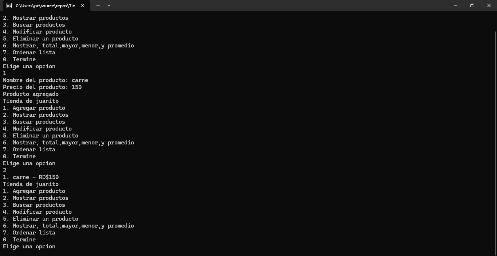
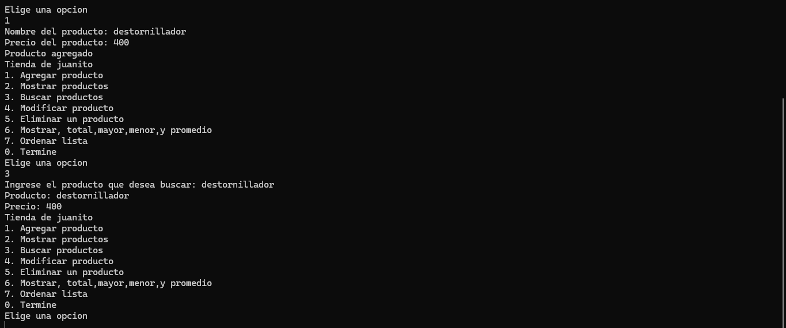
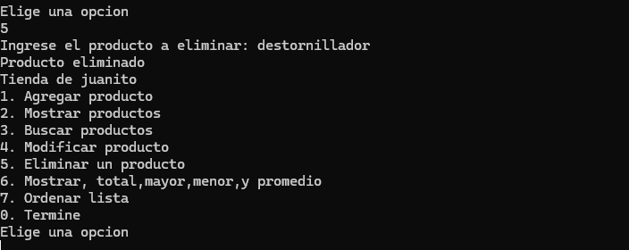
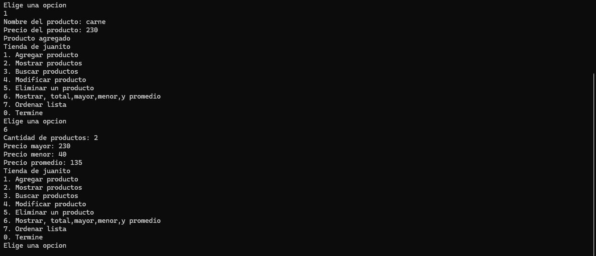
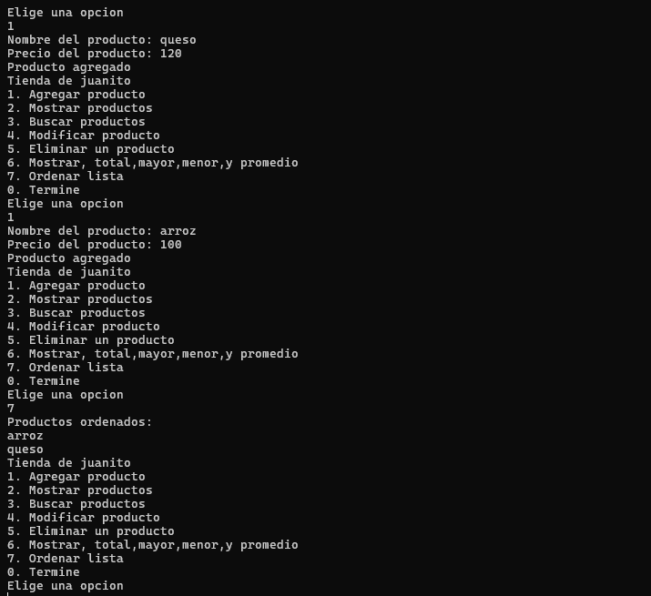
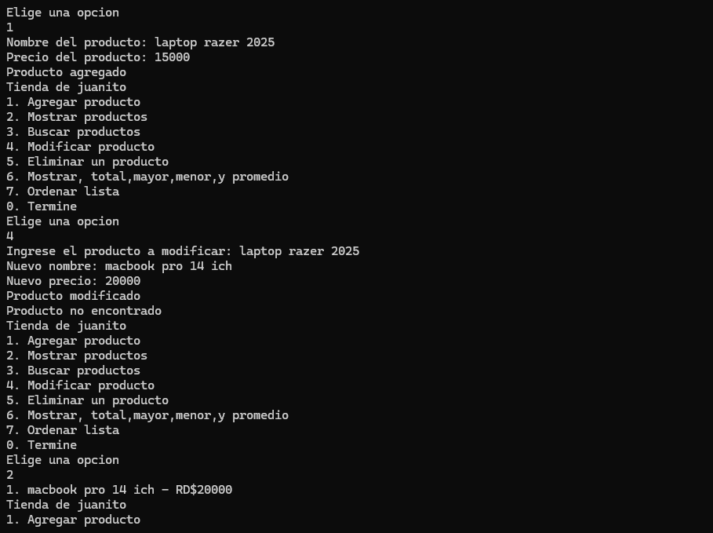
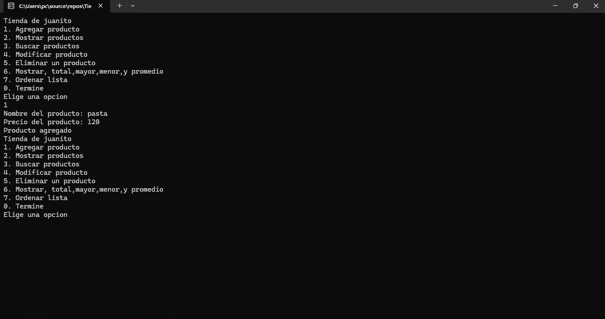

## Descripción
Este proyecto consiste en un programa  para gestionar los productos de una tienda llamada Tienda de Juanito

El sistema permite registrar productos y administrar sus precios mediante un menú de opciones.

## Tecnologías utilizadas

- C#
- .NET
- Visual Studio

## Autor
Yoiser Cedano

## Imagenes de ejecucion

## Capturas del programa

## 1 Mostrar 

## 2 Buscar producto

## 3 Eliminar producto

## 4 Mostrar estadisticas

### 5 ordenar

## 6 Modificar producto

 
## 7 Agregar producto 

 

